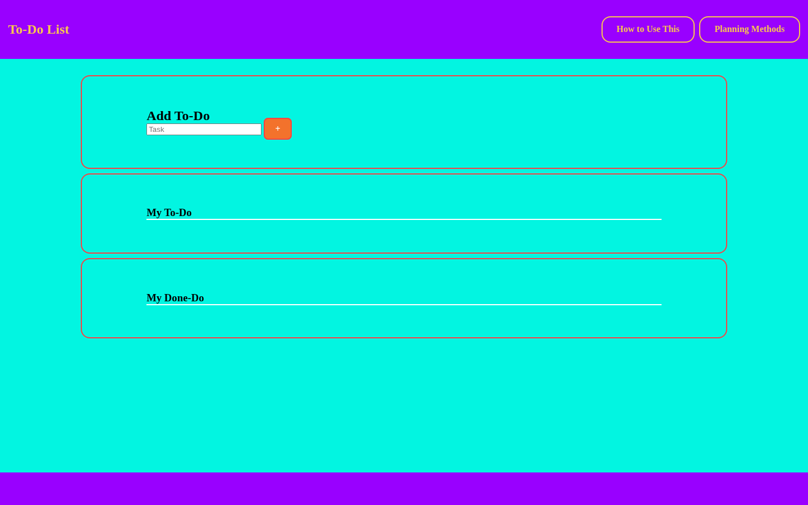

# Simple To-Do List

Add, complete, reopen, and delete tasks in a simple browser-based list.

## Overview

Simple To-Do List lets a user enter a task and add it to a To-Do list.

Each task includes a checkbox and delete button. Checking a task moves it to the Done-Do list, unchecking it moves the task back to To-Do, and deleting removes it from the page.

## Features

- Add a task
- Prevent empty tasks from being added
- Mark a task as complete
- Move completed tasks to the Done-Do list
- Move completed tasks back to the To-Do list
- Delete tasks
- Clear the input after adding a task

## Technologies

<p>
  <a href="https://developer.mozilla.org/en-US/docs/Web/HTML" title="HTML">
    
  </a>
  &nbsp;
  <a href="https://developer.mozilla.org/en-US/docs/Web/CSS" title="CSS">
    
  </a>
  &nbsp;
  <a href="https://developer.mozilla.org/en-US/docs/Web/JavaScript" title="JavaScript">
    
  </a>
</p>

## How to Run

1. Clone the repository:

```bash
git clone https://github.com/nilesleesmith/simple-todo-list.git
```

2. Open the project folder.

3. Open `index.html` in a web browser.

No additional packages or build steps are required.

## Project Context

This project was originally completed from a provided to-do-list coding assignment. The current repository contains the browser interface and JavaScript behavior used to add, move, and delete tasks.

## Live Site

https://nilesleesmith.github.io/simple-todo-list/

## Screenshots

